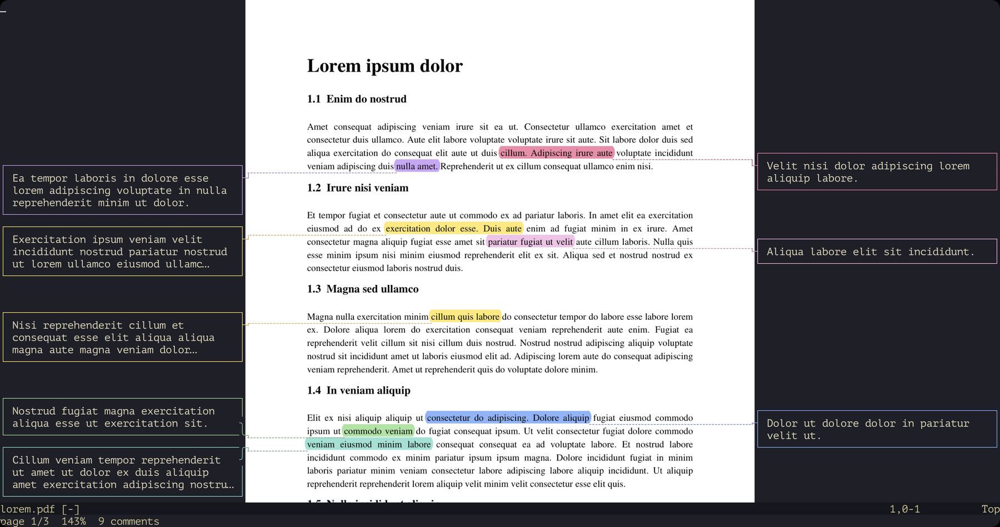

# pdf.nvim

Read and comment on PDFs inside Neovim. `nvim paper.pdf` shows the pages right
in the window, sharp and smooth to scroll, and you move around them with the
Vim keys you already know. Highlight text and write comments beside the page;
they are saved in the PDF itself, so Preview, Acrobat or a browser show them
too.



## What you need

- **A terminal that can show images**, since the pages are drawn as images.
  We tried these on macOS:

  | Terminal                                       | Works?                       |
  |------------------------------------------------|------------------------------|
  | [iTerm2](https://iterm2.com)                   | yes                          |
  | [Ghostty](https://ghostty.org)                 | yes                          |
  | [Kitty](https://sw.kovidgoyal.net/kitty)       | yes                          |
  | [WezTerm](https://wezterm.org)                 | yes                          |
  | [Rio](https://rioterm.com)                     | yes                          |
  | [VS Code](https://code.visualstudio.com)'s terminal | yes, after one setting: see [TERMINALS.md](TERMINALS.md#vs-code) |
  | Terminal (macOS's own)                         | no: it can't show images     |
  | [Tabby](https://tabby.sh)                      | no: it can't show images     |

  [TERMINALS.md](TERMINALS.md) has more on each.
- **Neovim 0.12** or newer.
- **Python 3 with PyMuPDF**, which renders the pages:

  ```sh
  pip install pymupdf
  ```

## Install

With [lazy.nvim](https://github.com/folke/lazy.nvim):

```lua
{ 'ajccosta/pdf.nvim' }
```

With [vim-plug](https://github.com/junegunn/vim-plug):

```vim
Plug 'ajccosta/pdf.nvim'
```

That's all. Open a PDF:

```sh
nvim paper.pdf
```

If PyMuPDF is installed in a virtualenv rather than for your usual `python3`,
tell pdf.nvim which Python to use:

```lua
require('pdf').setup({ python = vim.fn.expand('~/.venv/bin/python3') })
```

### Open PDFs from Finder (optional)

`macos/make-app.sh`, in the plugin's folder, makes `~/Applications/pdf.nvim.app`,
which opens each PDF in nvim in a new iTerm window. To make it the default for
PDFs: select a PDF in Finder, Get Info, Open with: pdf.nvim, Change All.

## Using it

### Reading

| Keys                              | Does                                       |
|-----------------------------------|--------------------------------------------|
| `h` `j` `k` `l`, `w` `b` `e` …    | move the cursor over the text, as in Vim   |
| CTRL-E CTRL-Y, mouse wheel        | scroll, on into the next page              |
| CTRL-D CTRL-U                     | scroll half a window                       |
| `n` `p` (or Space, Backspace)     | next / previous page                       |
| `gg` `G`, `3G`                    | first / last page, page 3                  |
| `+` `-`                           | zoom in / out                              |
| `zw` `zp`                         | fit the page's width / the whole page      |
| `v` `V`, or drag the mouse        | select text                                |
| `y`, `"+y`                        | copy the selection (to the clipboard)      |

Counts work as in Vim: `3n` is three pages on, `2+` zooms in twice. Each PDF
reopens where you left it.

### Comments

| Keys                              | Does                                       |
|-----------------------------------|--------------------------------------------|
| `c`                               | comment on the selection, or at the cursor |
| click a comment                   | edit it                                    |
| `x`                               | delete the comment under the cursor        |
| `u`, CTRL-R                       | undo, redo a change to the comments        |
| `C`                               | list all comments, editable as a file      |
| `m`                               | hide or show the comments beside the page  |
| `:PdfExport [file]`               | the comments as text: `highlighted text: comment` |

A comment opens in a box next to the page. Write in it as in any Vim buffer:
`:x`, or a click elsewhere, saves it into the PDF; `:q!` closes it without
saving. `:PdfColor green` picks the colour of new comments (`yellow`,
`orange`, `red`, `pink`, `purple`, `blue`, `teal`, `green`, or `#rrggbb`).

`:help pdf.nvim` has every key, command and setting.

## Settings

All optional. A few of them, at their defaults:

```lua
require('pdf').setup({
  python = 'python3',   -- a Python with PyMuPDF
  view = 'width',       -- open fitting the page's width (1: the whole page)
  color = 'blue',       -- new comments' colour
  notes_width = 40,     -- columns for the comments beside the page (0: none)
  notes_lines = 0,      -- most rows of each comment beside the page (0: all that fit)
  keys = { next = { 'n' } },  -- change any action's keys
})
```

## License

MIT; see [LICENSE](LICENSE).
